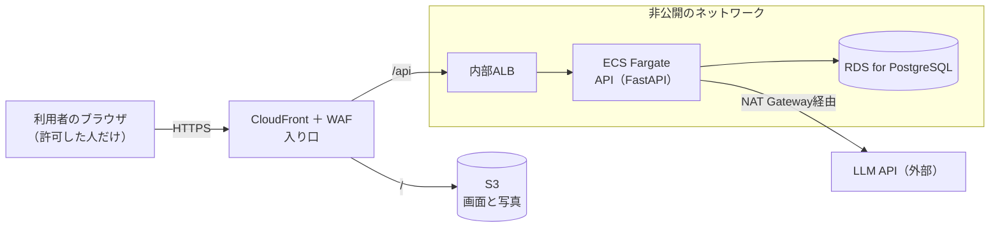

# クラウド版プロトタイプの構成（概要）

- ステータス: 設計のみ（未構築。実機での確認はしていない）
- 作成日: 2026-11-28
- 判断の理由と、検討した案: [ADR 0008](../adr/0008-cloud-prototype-aws.md)
- 全体の位置づけ: [時間計画・非機能要件・インフラ](non-functional-and-infra.md)の4章

この文書は、目的と前提、構成の概要、アプリ側の変更を扱う。インフラのコード（Terraform）と詳細な設計（リソース、料金、権限、セキュリティの確認、構築の手順）は、非公開のインフラ用リポジトリで管理する。

## 1. 目的と前提

開発PCを持ち運ばずに、プロトタイプをデモできるようにする。

| 項目 | 前提 |
|---|---|
| クラウド | AWS（東京リージョン）。複数のクラウドは組み合わせない |
| 利用者 | 利用を許可した人に限る（接続元のIPアドレスで制限する） |
| 利用の量 | 1日3時間程度を、1週間程度。少人数 |
| データ | 架空のデータだけを扱う。本物の個人情報は入力しない |
| 構成の方針 | 基本の構成は本番に近づける。可用性と負荷分散は考慮しない |
| データの保持 | データベースをサーバーの外に置き、アプリの再起動では消えないようにする |
| 認証の方針 | 長期のアクセスキーやAPIキーを使わない |
| 構成の管理 | Terraformで作る。画面での操作は、アカウントの作成などの初回の準備に限る |
| 費用 | AWSの新規利用者向けのクレジットの範囲に収める。LLMの利用料は別とする |

## 2. 構成の概要

- 画面とAPIは、CloudFrontの同じドメインに載せる。ローカルと同じく同一オリジンになり、Cookieの考え方を変えずに済む。
- テーブルの作成とデータの投入は、クラウド上の単発のタスクで行う。

## 3. 閉じ方と認証の方針

- 利用者が接続できる入り口は、CloudFrontだけにする。
- アプリとデータベースは、非公開のネットワークに置く。
- クラウドの中の接続と、LLMへの接続は、IAMロールと短命のトークンで認証し、長期のキーを置かない。
- 残る秘密情報は、クラウドの秘密情報の管理サービスに置く。暗号化の鍵は、クラウド専用に新しく作る。
- アプリのデプロイは、非公開のインフラ用リポジトリのワークフローから実行する。このリポジトリには、AWSの権限を持たせない。
- この構成は、架空のデータを使うデモ用である。本物の個人情報を扱う本番環境としては、不足している。

## 4. アプリ側で必要になる変更

| 対象 | 変更 |
|---|---|
| データベース | 接続先を設定で変えられるようにする。PostgreSQLのドライバーを追加し、接続のたびにIAMの認証トークンを取得する。サーバー証明書を検証する |
| テスト | PostgreSQLでもテストを実行する。予約の定員の処理を、同時実行を含めて確認する |
| Cookie | `Secure` を付けるかを、設定で指定できるようにする。今はリクエストがHTTPSかで判定していて、クラウドの構成では付かない |
| シード | クラウドのデモ用の実行環境（`APP_ENV`）を定め、パスワードを環境変数で渡せるようにする。本番環境で実行しないルールは残す |
| LLMの認証 | APIキーがない場合に、Workload Identity Federationで接続できるようにする。今は、キーの有無でモックとの切り替えを判定している |
| コンテナ | Dockerfileを追加する（管理者権限でないユーザーで実行する） |

アプリ用のDBユーザーの作成と権限の付与は、インフラ側の初期化の手順で行う。アプリのコードでは、これまでどおり生SQLを書かない。

## 5. 置き場所の分け方

| 内容 | 置き場所 |
|---|---|
| 目的と前提、構成の概要、アプリ側の変更 | この文書 |
| 構成を選んだ理由 | [ADR 0008](../adr/0008-cloud-prototype-aws.md) |
| Terraformのコード、詳細な設計、構築と削除の手順 | 非公開のインフラ用リポジトリ（準備中） |

同じ内容は、両方には書かない。
