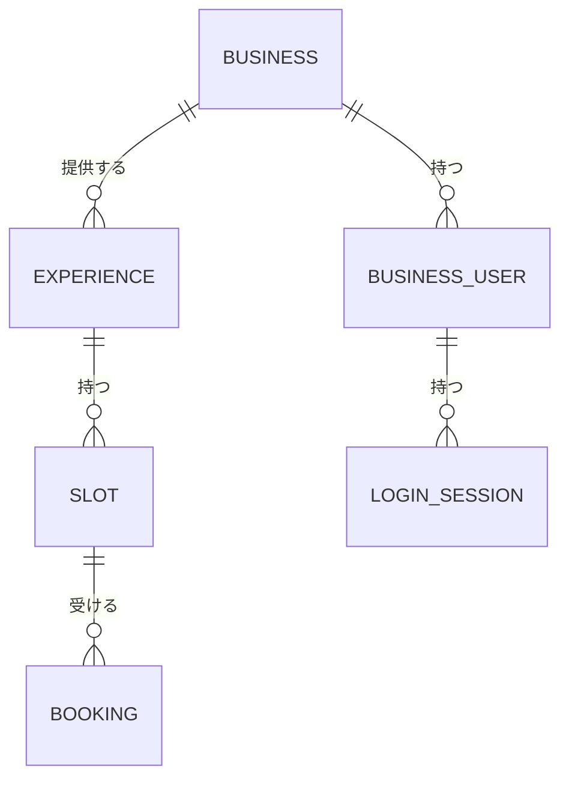
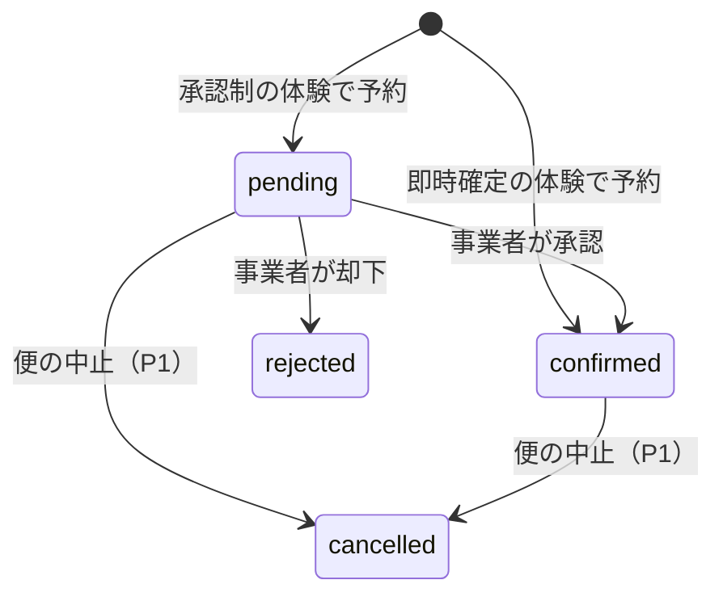
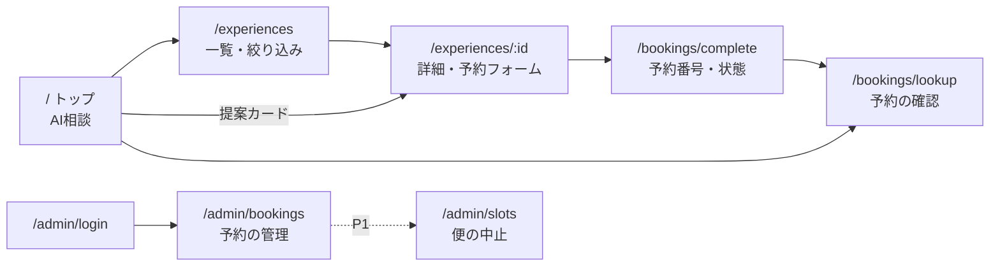
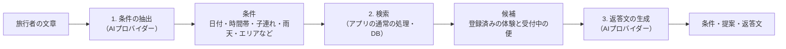

# 設計の概要（データモデル・API・画面・AI機能）

- ステータス: 確定（2026-11-23）
- 関連Issue: #1
- 前提: [MVPスコープ](mvp-scope.md)、[時間計画・非機能要件・インフラ](non-functional-and-infra.md)
- 関連ADR: [0002](../adr/0002-tech-stack-and-database.md)、[0003](../adr/0003-authentication-session.md)、[0004](../adr/0004-pii-encryption-and-masking.md)

テストと、必要なアウトプットの計画は、この文書が固まってから別に扱う。

## 1. 今回決めたこと

| # | 決めたこと | 理由 |
|---|---|---|
| 1 | **承認待ちの予約も、便の定員に数える**（予約を出した時点で定員を押さえ、却下したときに解放する） | 承認するときに「やっぱり満席」となる事故が起きない。ダブルブッキングを防ぐ原則と合う。欠点は、承認待ちの間も満席に見えること |
| 2 | **旅行者は「予約番号＋連絡先（電話またはメール）」で予約を確認する**。ログインは不要 | 番号だけでは、番号が漏れたときに第三者に見られる。連絡先は書いた本人しか知らない。連絡先はPOSTで送り、URLには入れない |
| 3 | **予約フォームは、氏名・電話番号・メールアドレスをすべて必須**とする | 事業者は緊急連絡のために連絡先を控えたい。海外の旅行者にはメールが主なので、両方を確実に取る |
| 4 | **シードのデモ用パスワードは、架空・デモ専用の固定値をシードに書く** | デモが楽で再現しやすい。本番環境ではシードを実行できないようにする（7章）。実在のパスワードは使わない |

## 2. ドメイン用語

| 用語 | 意味 |
|---|---|
| 事業者（Business） | 体験を提供する会社や個人 |
| 事業者アカウント（BusinessUser） | 事業者の管理画面にログインするためのアカウント。MVPでは事業者ごとに1つ |
| 体験（Experience） | 事業者が提供するアクティビティの内容。確定方式、子連れ可否、雨天可否などの属性を持つ |
| 便（Slot） | ある体験の、ある日・ある時間の1回分。定員と、予約済みの人数を持つ |
| 予約（Booking） | 旅行者が便に対して、人数と連絡先を添えて出す申し込み |
| 予約番号 | 予約ごとに発行する、推測されにくい番号。予約の確認に使う |
| 確定方式 | 「即時確定（instant）」と「承認制（approval）」。体験ごとに持つ |
| 予約済み人数（booked_count） | 便ごとに、承認待ちと確定の予約の人数を合計した値 |
| ゲスト | アカウントを持たずに予約する旅行者 |
| 条件（Conditions） | AIが文章から取り出す検索条件（日付、時間帯、子連れ可、雨天可など） |
| 提案（Suggestion） | AIが返す候補。登録済みの体験と、受付中の便と、選んだ理由の組 |
| 中止（P1） | 天候などで、便を実施しないこと。その便の予約は取り消しになる |

## 3. データモデル

### 3.1 ER図



### 3.2 テーブル

日時はすべてUTCで、タイムゾーン付きで保存する（ADR 0002）。IDは整数の連番とする。

**businesses（事業者）**

| 列 | 型 | 説明 |
|---|---|---|
| id | 整数 | 主キー |
| name | 文字列 | 事業者名 |
| area | 文字列 | 所在地域（例: 恩納村） |

**business_users（事業者アカウント）**

| 列 | 型 | 説明 |
|---|---|---|
| id | 整数 | 主キー |
| business_id | 整数 | 外部キー（事業者） |
| login_id | 文字列 | ログインID。一意 |
| password_hash | 文字列 | argon2idのハッシュ（ADR 0003） |

**login_sessions（ログインセッション）**

| 列 | 型 | 説明 |
|---|---|---|
| token_hash | 文字列 | セッションIDのSHA-256ハッシュ。主キー（ADR 0003） |
| business_user_id | 整数 | 外部キー |
| created_at | 日時 | 作成日時 |
| expires_at | 日時 | 有効期限 |

**experiences（体験）**

| 列 | 型 | 説明 |
|---|---|---|
| id | 整数 | 主キー |
| business_id | 整数 | 外部キー（事業者） |
| title | 文字列 | 体験の名前 |
| summary | 文字列 | 一覧に出す短い説明 |
| description | 文字列 | 詳細の説明 |
| category | 文字列 | `marine`（海）、`craft`（工芸）、`nature`（自然）、`food`（食） |
| area | 文字列 | 実施する地域 |
| meeting_point | 文字列 | 集合場所の説明 |
| price_yen | 整数 | 1人あたりの料金（円） |
| duration_minutes | 整数 | 所要時間（分） |
| kids_ok | 真偽 | 子連れ可 |
| min_age | 整数、空可 | 参加できる最低年齢 |
| rain_ok | 真偽 | 雨でも実施できる（屋内、または雨天対応） |
| minutes_from_naha | 整数 | 那覇から車での目安の時間（分）。「那覇から行ける」の判定に使う |
| confirmation_mode | 文字列 | `instant`（即時確定）または `approval`（承認制） |
| photo_url | 文字列 | 写真の場所 |
| map_url | 文字列、空可 | 地図のリンク（P1） |

**slots（便）**

| 列 | 型 | 説明 |
|---|---|---|
| id | 整数 | 主キー |
| experience_id | 整数 | 外部キー（体験） |
| starts_at | 日時 | 開始日時（UTC） |
| capacity | 整数 | 定員（1以上） |
| booked_count | 整数 | 予約済み人数（承認待ち＋確定）。0以上、定員以下 |
| status | 文字列 | `open`（受付中）、`cancelled`（中止。P1） |

制約: `0 <= booked_count <= capacity`（CHECK制約）。

**bookings（予約）**

| 列 | 型 | 説明 |
|---|---|---|
| id | 整数 | 主キー |
| booking_number | 文字列 | 予約番号。一意 |
| slot_id | 整数 | 外部キー（便） |
| party_size | 整数 | 人数（1以上） |
| status | 文字列 | `pending`（承認待ち）、`confirmed`（確定）、`rejected`（却下）、`cancelled`（取消。P1の便の中止で使う） |
| guest_name | 文字列（暗号化） | 氏名 |
| guest_phone | 文字列（暗号化） | 電話番号 |
| guest_email | 文字列（暗号化） | メールアドレス |
| created_at | 日時 | 作成日時 |
| decided_at | 日時、空可 | 承認・却下した日時 |

- 暗号化の対象は、`guest_name`、`guest_phone`、`guest_email`（ADR 0004）。暗号化した列は、検索や並べ替えに使わない。
- インデックス: `bookings(slot_id, status)`、`bookings(booking_number)`（一意）。
- 予約番号は、紛らわしい文字（0とO、1とIなど）を除いた英数字32種から、暗号論的乱数で10文字を作る。重複したら作り直す。

**P1で追加する、通知の記録（notifications）**: 便の中止のとき、参加者への連絡文を記録するテーブル。モックで送信する（実際には送らない）。連絡文には、個人情報を入れない。

**設計のみ（多言語対応）**: 体験の説明を言語別に持つために、`experience_translations(experience_id, language, title, summary, description)` を追加できる構造にしておく。日本語は、`experiences` の列を本体とする。

### 3.3 予約の状態遷移



- 旅行者による取り消し（キャンセル）は、MVPでは作らない（見送り）。状態の値は用意しておく。
- `rejected` と `cancelled` になった予約は、定員を解放する。

### 3.4 定員の更新ルール（ダブルブッキングの防止）

ADR 0002のとおり、行ロックに頼らず、**条件付きUPDATE**で行う。次はORMで表現する条件のイメージである。

**予約の作成（1つのトランザクション）**
1. 便を更新する。`booked_count` に人数を加算する。条件は「便が受付中」「開始前」「加算後の人数が定員以下」。
2. 更新された行が0なら、予約を作らず、`SLOT_UNAVAILABLE`（409）を返す。
3. 更新できたら、予約を作る。状態は、体験の確定方式で決まる（即時確定なら `confirmed`、承認制なら `pending`）。
4. どこかで失敗したらロールバックする。加算した定員も元に戻る。

**承認**: 予約を更新する。条件は「状態が `pending`」。更新された行が0なら `INVALID_STATE`（409）。定員は変えない（作成時に押さえてある）。

**却下**: 同じトランザクションで、予約を `rejected` にして、便の `booked_count` から人数を引く。条件は「状態が `pending`」。

**認可**: 事業者向けのAPIは、予約から便と体験をたどり、体験の事業者が、ログイン中の事業者と一致する行だけを対象にする。一致しない予約は、存在しないもの（404）として扱う。

## 4. API

すべて `/api` の下に置く。旅行者向けは認証不要、事業者向けは `/api/admin` の下に置き、ログインが必要。

### 4.1 旅行者向け（認証不要）

| メソッド | パス | 内容 |
|---|---|---|
| GET | `/api/experiences` | 体験の一覧。クエリ: `date`、`party_size`、`kids_ok`、`rain_ok`、`area`、`category`、`max_minutes_from_naha` |
| GET | `/api/experiences/{id}` | 体験の詳細と、受付中の便（残席つき） |
| POST | `/api/bookings` | 予約を作る。本文: `slot_id`、`party_size`、`guest_name`、`guest_phone`、`guest_email`。成功は201で、`booking_number` と `status` を返す |
| POST | `/api/bookings/lookup` | 予約を確認する。本文: `booking_number`、`contact`（電話またはメール）。一致したら、体験名・日時・人数・状態・集合場所を返す。個人情報は返さない |
| POST | `/api/concierge/search` | AIコンシェルジュ。本文: `message`。条件・提案・返答文を返す（5章） |

- 予約の確認で、番号が存在しない場合も、連絡先が一致しない場合も、同じ404を返す（番号の存在を推測させない）。
- 入力はPydanticで検証する。電話番号とメールの形式、人数が1以上で、便の残席以下であることなどを確認する。
- 試行回数の制限（予約の確認、ログイン）は、本格開発の設計とする（ADR 0003）。

### 4.2 事業者向け（要ログイン）

| メソッド | パス | 内容 |
|---|---|---|
| POST | `/api/admin/login` | 本文: `login_id`、`password`。成功するとCookieにセッションを設定する |
| POST | `/api/admin/logout` | サーバー側のセッションを削除する |
| GET | `/api/admin/me` | ログイン中の事業者の情報 |
| GET | `/api/admin/slots` | 自社の便の一覧と、便ごとの予約状況（承認待ち・確定の人数）。クエリ: `date` |
| GET | `/api/admin/bookings` | 自社の予約の一覧。クエリ: `status`、`slot_id`、`date`。氏名・電話・メールはマスク済みで返す |
| POST | `/api/admin/bookings/{id}/approve` | 承認制の予約を承認する |
| POST | `/api/admin/bookings/{id}/reject` | 承認制の予約を却下する |
| GET | `/api/admin/bookings/{id}/contact` | 1件の予約の、氏名・電話・メールを平文で返す。`Cache-Control: no-store` を付ける |
| POST | `/api/admin/slots/{id}/cancel`（P1） | 便を中止する。便の予約を `cancelled` にし、連絡文の下書きと、通知の記録（モック）を返す |

### 4.3 マスクの形式（例）

| 項目 | 元の値（架空） | マスク後 |
|---|---|---|
| 氏名 | 山田 花子 | 山*** |
| 電話番号 | 090-1234-5678 | 090-****-5678 |
| メール | hanako@example.com | h***@example.com |

マスクは、サーバー側で行う（ADR 0004）。

### 4.4 エラーの形

すべてのエラーを、次の形に統一する。FastAPIの既定の形式は、専用の処理で置き換える。

```json
{ "error": { "code": "SLOT_UNAVAILABLE", "message": "この便は満席、または受付を終了しています。" } }
```

| コード | HTTP | 意味 |
|---|---|---|
| VALIDATION_ERROR | 422 | 入力が正しくない |
| UNAUTHENTICATED | 401 | ログインが必要、または期限切れ |
| NOT_FOUND | 404 | 存在しない、または見る権限がない |
| SLOT_UNAVAILABLE | 409 | 満席、または受付を終了した便に予約しようとした |
| INVALID_STATE | 409 | すでに承認・却下された予約を、さらに承認・却下しようとした |

## 5. 画面構成

### 5.1 画面の一覧

**旅行者（スマホ幅を基本にし、PC幅にも対応する）**

| パス | 画面 | 要点 |
|---|---|---|
| `/` | トップ | AIコンシェルジュの入力欄、よく使う条件（子連れOK、雨でもOK）のショートカット、一覧への入口 |
| `/experiences` | 体験の一覧 | 絞り込み（日付、人数、子連れ可、雨天可、エリア）。写真を大きく見せる |
| `/experiences/:id` | 体験の詳細・予約 | 写真、説明、料金、集合場所、子連れ可否。便の選択（残席の表示）と、予約フォーム（氏名・電話・メール・人数） |
| `/bookings/complete` | 予約の完了 | 予約番号と状態（確定、または承認待ち）。番号を控えるよう案内する |
| `/bookings/lookup` | 予約の確認 | 予約番号と連絡先を入力して、状態を見る |

**事業者（PC幅を基本にし、スマホ幅にも対応する）**

| パス | 画面 | 要点 |
|---|---|---|
| `/admin/login` | ログイン | ログインIDとパスワード |
| `/admin/bookings` | 予約の管理 | 便ごとに予約を並べる。承認待ちを目立たせ、承認・却下をワンタップで行う。連絡先は伏せ字で表示し、「連絡先を表示」で全体を見る |
| `/admin/slots`（P1） | 便の一覧と中止 | 便を中止にして、参加者への連絡文を出す |

### 5.2 画面の遷移



### 5.3 使いやすさの方針
- 旅行者の画面は、スマホで片手で操作できる大きさにする。入力欄は大きくし、予約は「便を選ぶ→入力→送信」の3ステップで終える。
- 画面は、スマホ幅でもPC幅でも使えるレスポンシブにする。境目は `lg:`（1024px）の1つで、それより狭い幅は縦1列、広い幅は複数列にする（[ADR 0005](../adr/0005-responsive-layout.md)）。
- 事業者の画面は、1画面で用が済むようにする。承認待ちの件数を上に出し、承認・却下は一覧から直接行う。
- 子連れ可、雨天可などは、アイコンと短い文字で一覧のカードに出す。

## 6. AI機能の設計

### 6.1 役割
AIコンシェルジュは、旅行者の**「探す入口」**である。「今日の午後、那覇から行ける子連れOKの体験ある？」のような文章から、検索条件を取り出し、登録済みの体験から候補を探し、理由つきで提案する。**予約の実行はしない。** 提案から、体験の詳細・予約の画面へ進む。

### 6.2 処理の流れ



- **検索はAIに任せない。** アプリの通常の処理（DBの検索）で行う。AIは、条件の抽出と、返答文の生成だけを担う。
- これにより、存在しない体験を提案する（幻覚）ことを防ぎ、候補の空き状況は常にDBの値になる。
- 旅行者の文章は、AIに渡す前に、個人情報らしき文字列（電話番号・メールなど）を伏せる（6.7）。

### 6.3 入出力

**入力**: `message`（文章）。現在の日時（日本時間）は、サーバー側で渡す。

**条件（Conditions）**: すべて空にできる。

| 項目 | 内容 | 例 |
|---|---|---|
| date | 日付 | 「今日」→ 今日の日付 |
| time_from, time_to | 時間帯 | 「午後」→ 12:00〜18:00 |
| party_size | 人数 | 「3人」→ 3 |
| kids_ok | 子連れ可で絞るか | 「子連れ」→ true |
| rain_ok | 雨でも実施できるもので絞るか | 「雨」→ true |
| area | 実施する地域 | 「恩納村」 |
| max_minutes_from_naha | 那覇からの移動時間の上限（分） | 「那覇から行ける」→ 60 |
| category | 種類 | 「シュノーケル」→ marine |

**出力**:
```json
{
  "conditions": { "date": "2026-12-01", "time_from": "12:00:00", "time_to": "18:00:00", "kids_ok": true, "max_minutes_from_naha": 60 },
  "suggestions": [
    {
      "experience_id": 3, "title": "型染めコースター体験", "summary": "…", "photo_url": "/photos/coaster.svg",
      "price_yen": 3800, "confirmation_mode": "approval",
      "reason": "子連れOK・雨でも実施・那覇から約10分・12/1 14:00の便は残り4席・予約は事業者の承認後に確定",
      "slots": [ { "id": 21, "starts_at": "2026-12-01T05:00:00Z", "capacity": 4, "remaining": 4, "is_full": false } ]
    }
  ],
  "reply": "12月1日の午後、子連れOK、那覇から60分以内という条件で、1件の体験が見つかりました。…"
}
```

- `conditions` の、読み取れなかった項目は `null`。`slots` の形は、他のAPI（体験の一覧）と同じ。
- **`reason` は、AIではなく、アプリが、DBの事実から作る**。画面は、体験のカード（`title`、`photo_url`、`price_yen` など）と便を、このレスポンスだけで表示できる。

### 6.4 モックの仕組み（MVP）
**ルールベース**で、LLMを使わずに同じ入出力を返す。

- 条件の抽出: キーワードと正規表現で取り出す。
  - 日付: 「今日」「明日」「あさって」
  - 時間帯: 「午前」「午後」「夜」
  - 人数: 「◯人」
  - 子連れ: 「子連れ」「子ども」「家族」
  - 雨: 「雨」「悪天候」「天気が悪い」
  - 那覇: 「那覇から」
  - エリア名と種類の語は、辞書で対応させる。
- 返答文の生成: テンプレートに、条件の要約と、候補ごとの理由（子連れ可、雨天可、移動時間、残席）を入れる。候補が0件なら、条件を緩める提案を返す（例: 「雨の条件を外すと◯件あります」）。緩め方は、アプリが、条件を1つずつ外してDBで再検索し、**件数のあるものだけ**を、AIプロバイダーに渡す。読み取れる言葉の詳細は、`backend/app/ai/mock_provider.py` の冒頭に書いてある。
- 条件がまったく取れなかったときは、一覧の画面へ誘導する文を返す。

### 6.5 実装レベルの判断
| 判断 | 理由 |
|---|---|
| まず**モック（ルールベース）**で作る | 入出力の約束と、画面・検索の流れを、短い時間で固めて、デモできる。LLMのキーや費用、応答の揺れに左右されない |
| LLMへの接続は、モックの流れが動いたあとに、**実装した**（[ADR 0007](../adr/0007-llm-provider.md)） | 差し替える場所を、条件の抽出と返答文の生成の2つに限定していたので、短時間で足せた。モックは、キーがないときと、LLMが失敗したときの代替として残した |
| 検索と予約は、**AIに任せない** | 幻覚の防止、個人情報の保護、コストの抑制のため |

### 6.6 AIプロバイダーの差し替え

次の2つの操作を持つ「AIプロバイダー」の約束事（インターフェース）を定義する。

- `extract_conditions(message, now) -> Conditions`
- `compose_reply(conditions, candidates, relaxations) -> str`（`relaxations` は、0件のときの、件数のある緩め方）

環境変数 `ANTHROPIC_API_KEY` があれば、LLM（Claude）で答え、なければ、モックで答える。LLMが失敗したときも、モックで答える。APIキーは `.env` に置き、コミットしない（秘密情報の管理は、非機能要件のとおり）。モデルは、環境変数 `ANTHROPIC_MODEL` で選ぶ（既定は `claude-haiku-5-5`）。LLMを選んだ理由と、参考にした比較表は、[ADR 0007](../adr/0007-llm-provider.md)にある。

**LLM版の設計（実装済み）**
- LLMの担当は、①条件の抽出と、②返答の冒頭の1〜2文だけ。条件は、構造化出力（JSONスキーマ）で受け取り、`Conditions` で検証する。形が正しくなければ、失敗として、モックで答える。
- LLMに渡すのは、①旅行者の文章（個人情報を伏せたあと）と今日の日付、②読み取った条件と、見つかった体験の体験名・要約・理由・料金（最大5件。ガードを通す）。**予約者の個人情報と、体験の説明文・事業者名・便の詳細は、渡さない。** 候補が0件のときは、LLMを呼ばない。
- 返答の残り（候補の一覧、条件を緩める提案、締めの案内）は、モックと同じテンプレートで、アプリが作る。
- 待ち時間は20秒、再試行は1回。失敗したときは、モックで答え、30秒間は、LLMを呼ばない。
- 出力の長さには上限がある。呼び出し回数の上限は、アプリでは設けない（Consoleの月額の上限と、前払いの残高で止める）。

### 6.7 安全策
- **個人情報**: AIへの入力は、旅行者の文章と、現在の日時（返答には、読み取った条件と件数）だけにする。予約者の連絡先は渡さない（テストで固定している）。旅行者の文章は、AIに渡す前に、電話番号・メールアドレス・郵便番号・カード番号らしき文字列を伏せる（`app/ai/pii_guard.py`）。**氏名と住所は、形が決まっていないので、確実には検知できない**（残るリスク。ADR 0007）。画面には「氏名や電話番号は入力しないでください」と表示し、サーバーのログには入力の全文を残さない。
- **プロンプトインジェクション**: 旅行者の文章は、条件の抽出の入力にだけ使う。AIの出力は、スキーマで検証したうえで、検索条件としてだけ使う。AIの出力でアクション（予約、更新など）を実行しない。
- **失敗への備え**: LLMが失敗したときは、モックで答える。条件が取れないときは、一覧の画面へ誘導する。

## 7. シードデータの方針

公開前提のため、すべて架空のデータにする。事業者名は、実在の事業者と重ならないものにする。

| 項目 | 内容 |
|---|---|
| 事業者 | 4社（海、工芸、自然、屋内の食）。名前は架空（例: 潮風マリンサービス、島染め工房ひだまり、やんばる星空ガイド、島ごはん教室）。実装時に、実在の事業者と重ならないかを確認する |
| 体験 | 8件程度。即時確定と承認制を混ぜる。子連れ可、雨天可を、いくつかの体験に付ける。「雨の代わり」になる屋内の体験を2件以上入れる |
| 便 | 今日から1週間分。今日の午後の便を必ず含める。満席の便を1つ入れる |
| 予約 | 架空の氏名、`example.com` のメール、ダミーの電話番号。承認待ちの予約を数件入れる |
| 事業者アカウント | 事業者ごとに1つ。ログインIDとパスワードは、架空・デモ専用の固定値をシードに書く。**本番環境（環境変数 `APP_ENV=production`）では、シードを実行しない** |
| 写真 | 自作、生成、またはライセンスが明確なものだけを使う。実在の施設や人物が写った写真は使わない。決まらなければプレースホルダーの画像にする |

### 7.1 デモの流れ（5分程度）
1. スマホ幅の画面で、AIコンシェルジュに「今日の午後、那覇から行ける子連れOKの体験ある？」と聞く。提案から、承認制の体験の詳細へ進み、予約する。「承認待ち」と予約番号が出る。
2. 事業者の画面にログインする。承認待ちの予約が見える。連絡先が伏せ字になっていることを見せ、「連絡先を表示」を押す。承認する。
3. 旅行者の画面で、予約番号と連絡先で予約を確認する。「確定」になっている。
4. 満席の便に予約しようとして、断られることを見せる（定員の管理）。
5. （余裕があれば）便を中止にして、参加者への連絡文を出す（P1）。

## 8. 評価ポイントとの対応

| 評価ポイント | 示す場所 |
|---|---|
| 課題の理解 | [MVPスコープ](mvp-scope.md)の3章（利用者と困りごと） |
| スコープ・優先順位の判断 | MVPスコープの5章（決めたこと）、7章（優先度）、8章（MVPの定義） |
| 設計力 | この文書の3章（データモデル、定員の更新ルール）、4章（API） |
| スピード感 | [時間計画・非機能要件・インフラ](non-functional-and-infra.md)の1章、[ADR 0002](../adr/0002-tech-stack-and-database.md) |
| ユーザビリティ | この文書の5章（画面構成）、MVPスコープの6章（中核ユーザーフロー） |
| AI機能の設計 | この文書の6章 |
| AI活用力 | 実装の開始時にまとめる（開発でのAI活用方法と、`docs/ai-dev-log.md`） |
| プロトタイプの完成度 | 実装後。この文書の7.1（デモの流れ）で確認する |

## 9. 未決事項・次にやること

| # | 内容 | 決める場所 |
|---|---|---|
| 1 | 開発でのAI活用方針（指示・分業・レビューの方法）の文書化 | 実装の開始時 |
| 2 | 見送り事項と、「本格開発で次にやること」の文書化 | 設計資料の仕上げ |
| 3 | テストと、必要なアウトプットの計画 | この文書の確定後に相談 |
| 4 | `AGENTS.md` の空欄（概要・技術スタック・コマンド）を埋める | 実装の開始時 |
