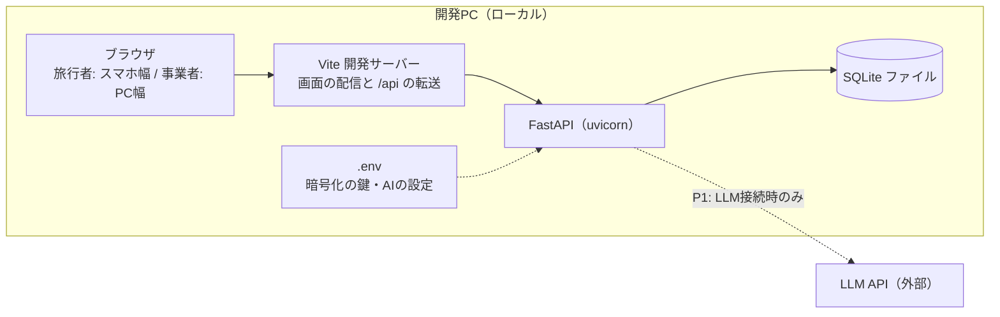
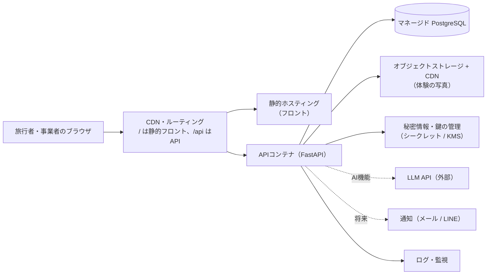

# 時間計画・非機能要件・インフラ

- ステータス: 確定（2026-11-23）
- 関連Issue: #1
- 前提: [MVPスコープ](mvp-scope.md)
- 関連ADR: [0002 技術スタックとデータベース](../adr/0002-tech-stack-and-database.md)、[0003 ログイン方式](../adr/0003-authentication-session.md)、[0004 個人情報の暗号化とマスク](../adr/0004-pii-encryption-and-masking.md)

テストと、必要なアウトプットの計画は、機能・非機能の設計が固まってから別に扱う。データモデル、API、画面、AI機能の詳細は設計セッション3で扱う。

## 1. 時間計画（5時間を狙う）

作業時間の目安は4〜6時間で、5時間を狙い、6時間を上限とする。個人情報の保護と認証・認可がP0に入ったため、配分を組み直した。

| # | 区間 | 内容 | 時間 | 完了の目安 |
|---|---|---|---|---|
| 1 | 設計 | 設計セッション1〜3、設計資料のドラフト、ADR | 1:00 | 設計資料のドラフトとADRがある |
| 2 | 環境構築・雛形 | `backend/` と `frontend/`、`.env.example`、シードの土台、起動確認 | 0:20 | 画面とAPIが起動し、つながる |
| 3 | バックエンド | モデル、暗号化、ログイン・セッション・認可、体験・便・予約のAPI、定員の条件付きUPDATE、承認・却下、AIのモック | 1:20 | 「予約→承認→確定」と「満席の拒否」がAPIで通る |
| 4 | フロントエンド | 旅行者: 一覧・詳細・予約・予約確認・AI相談。事業者: ログイン・予約一覧・承認・却下 | 1:30 | 画面から中核の流れが通る |
| 5 | 結合・デモ動線 | 通しの動作確認、シードデータの調整 | 0:20 | デモを通しで実演できる |
| 6 | 仕上げ | 設計資料の仕上げ、`docs/ai-dev-log.md` の記録、デモの練習 | 0:30 | 提出物がそろう |
| | 合計 | | 5:00 | |

- 各区間のバッファ（約1割）は、上の時間に含めている。
- セキュリティ（暗号化、認証、認可、マスク表示）の分は、区間3に約25分、区間4に約10分を含めた（目安）。
- テストの分は、区間3に約25分、区間4に約5分（型チェック・lint・ビルド）、区間5に約10分（手動のデモチェック）を含める（目安）。実装と同時にAIに書かせる前提で見積もっている。詳細は[テスト計画と成果物の計画](test-and-deliverables-plan.md)に書いた。
- **予備枠（5:00〜6:00）**: P1の機能（中止と一斉連絡、集合場所、LLM接続）か、クラウドへのデプロイに使う。使うかどうかは、下のチェックポイントで決める。

### 1.1 チェックポイント

| 経過時間 | 確認すること | 遅れていたら |
|---|---|---|
| 2:00（区間3の中間） | モデル・暗号化・認証の土台と、主要なAPIが動いている | テストを、定員・認可・個人情報（P0の1〜3）に絞る |
| 2:40（区間3の終わり） | APIで「予約→承認→確定」「満席の拒否」が通る | P1はすべてやめる。フロントの絞り込みUIを最小にする |
| 4:10（区間4の終わり） | 画面から中核の流れが通る | AI相談の画面を最小にする（入力欄と結果の一覧だけ） |
| 4:30（区間5の終わり） | デモを通しで実演できる | 予備枠を結合の修正に使い、P1もデプロイもやらない |

### 1.2 縮小する順番
[MVPスコープ](mvp-scope.md)の8.4と同じ順番とする。

1. 便の中止と一斉連絡（P1）をやめる
2. LLM APIへの接続（P1）をやめる（モックのまま）
3. 集合場所の案内（P1）を、説明文だけにする

P0の機能は縮小しない。個人情報の保護と認証・認可もP0なので、縮小の対象にしない。

## 2. 技術スタック

| 領域 | 採用 | 備考 |
|---|---|---|
| フロントエンド | React、TypeScript、Vite、React Router、TanStack Query、Tailwind CSS | スマホファーストで素早く画面を作る。詳細はADR 0002 |
| バックエンド | Python、FastAPI、Pydantic、SQLAlchemy 2.x | 指定のスタック。DBへのアクセスはORMのみ |
| データベース | SQLite（ファイル） | 本格開発ではPostgreSQLに切り替える。切り替えやすくするルールをADR 0002に定めた |
| ログイン | サーバー側セッション＋HttpOnly Cookie。パスワードはargon2idでハッシュ化 | ADR 0003 |
| 個人情報の保護 | アプリ側でフィールドごとに暗号化（Fernet）。画面へはサーバー側でマスクして返す | ADR 0004 |
| 型の共有 | FastAPIのOpenAPIから、TypeScriptの型を生成する | 遅れたら手書きの型で代替する |
| AI機能 | プロバイダーを差し替えられる設計。まずモック、P1でLLM API | 詳細は設計セッション3 |

実装の開始時やテスト計画の相談で決めるもの: Pythonのパッケージ管理、テスト・lint・型チェックのツール。

## 3. 非機能要件

「実施」はプロトタイプで実装する、「一部」は最小限だけ実装する、「設計のみ」は本格開発向けに方針だけ書く、を表す。

| 観点 | 方針 | プロトタイプ |
|---|---|---|
| 認証・認可 | サーバー側セッション。事業者は自分の体験の予約だけを見られる。パスワードはargon2idでハッシュ化。ログイン失敗のメッセージは統一する（ADR 0003） | 実施 |
| 個人情報の保護 | 予約者の氏名・電話番号・メールを暗号化して保存する。一覧ではサーバー側でマスクして返す。ログとAIへの入力に個人情報を入れない（ADR 0004） | 実施 |
| Webの基本的な対策 | 入力はPydanticで検証する。SQLはORMのみ（SQLインジェクション対策）。Reactの既定のエスケープに任せ、`dangerouslySetInnerHTML` は使わない（XSS対策）。画面とAPIを同じオリジンで動かし、`SameSite=Lax` と、変更系をPOST/PATCH/DELETEに限る方針でCSRFを抑える | 実施 |
| セキュリティの追加対策 | CSRFトークン、セキュリティヘッダー、ログイン試行の制限、多要素認証、表示操作の監査ログ | 設計のみ |
| 秘密情報の管理 | 鍵とAPIキーは `.env` に置き、コミットしない。`.env.example` には名前と生成方法だけを書く | 実施 |
| データの整合性 | 定員の更新は条件付きUPDATEで行い、ダブルブッキングを防ぐ。日時はUTCで保存する | 実施 |
| 使いやすさ・端末 | スマホファースト（幅375px程度から）。タッチ操作しやすい大きさ。事業者の画面は最小の操作で済ませる | 実施 |
| アクセシビリティ | 意味のあるHTML要素、十分な文字のコントラスト、入力欄のラベル | 一部 |
| 保守性・変更しやすさ | API・サービス・DBアクセスの層を分ける。AIプロバイダーとDBを差し替えられる構造にする | 実施 |
| 運用・観測性 | 個人情報を含まないログ、ヘルスチェック用のAPI | 一部 |
| 性能 | 通常の画面操作で、APIの応答が1秒以内（目安）。本格開発では、一覧のページング、検索のインデックス、計測にもとづく目標値を決める | 設計のみ |
| 可用性・バックアップ | マネージドDBの自動バックアップを使う。復旧目標（どれだけ止まってよいか、どれだけ失ってよいか）は本格開発で決める | 設計のみ |
| 多言語・タイムゾーン | 保存はUTC、表示は日本時間。文言を差し替えられるようにする。体験の説明などを言語別に持てるデータ構造にする（設計セッション3） | 設計のみ |
| 法令・プライバシー | 利用目的の明示、保持期間と削除、プライバシーポリシー、事業者との取り決め。法的な確認が必要な項目として本格開発の前に洗い出す | 設計のみ |
| AI機能の品質 | 処理に時間制限を設け、失敗したときは通常の絞り込みに戻す。提案は登録済みの体験だけから返す（存在しない体験を作らせない）。入力は条件抽出だけに使い、出力は検証してから使う。LLM接続時は利用量の上限を設ける | 一部（モックで流れを示す） |

## 4. インフラ

MVPはローカルで実行し、画面共有でデモする。クラウドは設計のみ行い、予備枠で時間が余れば対応する。

### 4.1 ローカル構成（プロトタイプ）

- 起動は、バックエンドとフロントエンドの2コマンド（シード投入を含めた具体的なコマンドは、実装の開始時に `AGENTS.md` に書く）。
- 画面とAPIは、Viteの開発サーバーの転送により同じオリジンで動く。そのため、CORSの設定は不要で、Cookieも素直に動く。
- 旅行者の画面はスマホ幅、事業者の画面はPC幅で、同じPCの別タブまたは別ウィンドウに並べてデモする。
- SQLiteのファイルと `.env` はコミットしない（`.gitignore` に追加する）。デモ用のデータは、シードのコマンドでいつでも作り直せる。

### 4.2 クラウド構成の設計（本格開発）

- フロントとAPIを同じドメインに載せる。ローカルと同じく同一オリジンとなり、Cookieの設定を変えずに済む。
- DBはファイルのSQLiteから、マネージドのPostgreSQLに切り替える。切り替えやすくするルールは、ADR 0002に定めた。
- セッションはDBに持つので、APIコンテナを複数に増やしても共有できる（10〜20社の規模なら十分）。

### 4.3 候補の比較

特定のサービスに閉じないよう、コンテナなど移植しやすい形を優先する。料金・東京などの国内リージョンの有無・機能は、選ぶ時点で最新の情報を確認する。

| 部品 | 役割 | 候補の例 | 選ぶ観点 |
|---|---|---|---|
| フロントの配信 | 静的ファイルの配信、CDN | Cloudflare Pages、Vercel、AWS（S3 + CloudFront）、Firebase Hosting | 配信の速さ、デプロイの簡単さ、独自ドメインとHTTPSの扱い |
| APIの実行 | FastAPIのコンテナ実行 | Google Cloud Run、AWS App Runner、AWS ECS Fargate、Fly.io、Render | 運用の軽さ、アクセスが少ない間のコスト、国内リージョン、ほかの部品との相性 |
| データベース | マネージドPostgreSQL | Neon、Supabase、Google Cloud SQL、Amazon RDS | 自動バックアップ、国内リージョン、接続数の制限、料金体系 |
| 画像の保存 | 体験の写真 | Amazon S3、Google Cloud Storage、Cloudflare R2 | 配信用CDNとの連携、料金（転送量）、画像の変換機能 |
| 認証 | 事業者・運営のログイン | 自前のセッションを継続、Auth0、Amazon Cognito、Supabase Auth、Firebase Authentication | 運用の手間、多要素認証の対応、ほかの部品との相性、乗り換えやすさ |
| 秘密情報・鍵 | 暗号化の鍵、APIキー | AWS KMS と Secrets Manager、Google Cloud の Secret Manager と Cloud KMS | 鍵のローテーション、アクセス権の管理、実行基盤との相性 |
| ログ・監視 | 障害の検知 | 実行基盤が持つ標準のログと監視、Sentry | 個人情報をログに出さない設定のしやすさ、通知の仕組み |

選ぶときの考え方:
- 小規模（10〜20社）からの開始なので、運用の手間が少なく、使った分だけ払う形を優先する。
- 利用者は沖縄を訪れる旅行者なので、日本国内のリージョンを使えることを重視する。
- DBと認証は乗り換えにくい。ここだけは、本格開発の前に別途ADRを書いて決める。

### 4.4 予備枠でデプロイする場合の方針
予備枠（5:00〜6:00）で、P0の通しのデモが完了していれば、クラウドへのデプロイを試す。

- 最小の構成は、APIコンテナ1つ、マネージドPostgreSQL、静的なフロントの配信。
- クラウドではSQLiteのファイルを使えないので、デプロイにはPostgreSQLへの切り替えが必要になる（ADR 0002のルールを守っていれば、接続先の変更が中心になる）。
- 1時間では終わらない可能性がある。その場合は無理に続けず、設計のみで止める。

## 5. 未決事項

| # | 内容 | 案 | 決める場所 |
|---|---|---|---|
| 1 | Pythonのパッケージ管理（`uv` か、`pip` と `venv` か） | 実装の開始時に、環境を確認して決める | 実装開始時 |
| 2 | テスト・lint・型チェックのツールと、実行コマンド | テスト計画の相談で決める | テスト計画 |
| 3 | シードのデモ用パスワードの扱い | 架空・デモ専用と明記し、本番環境ではシードを実行しない | 設計セッション3 |
| 4 | クラウドのサービス選定 | 本格開発の前に、料金とリージョンを確認してADRに残す | 本格開発の前 |
