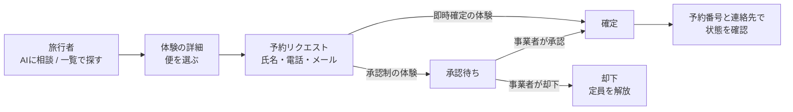
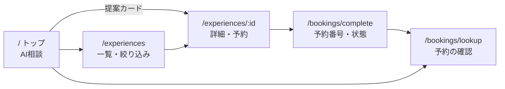
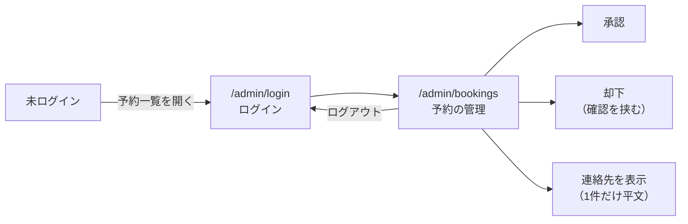
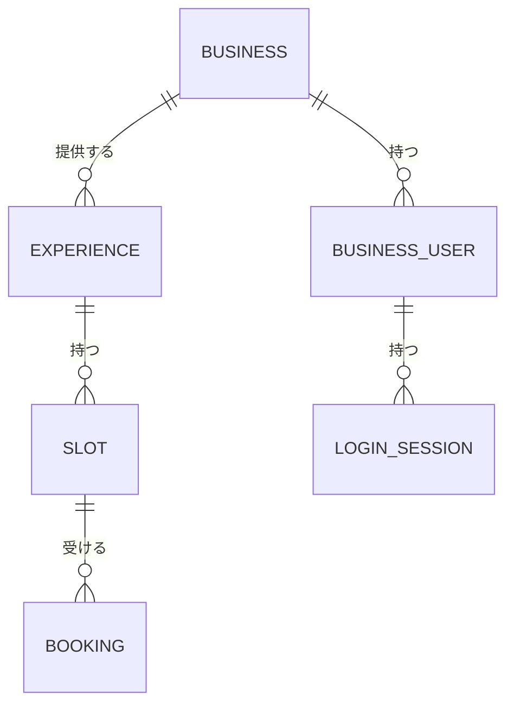
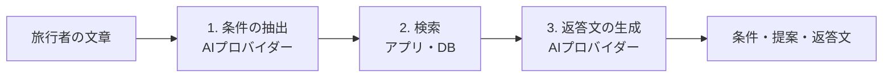

# シマタビ（仮）設計の要約

- 沖縄の小規模な体験事業者と旅行者をつなぐ、体験予約プラットフォームのMVPの設計と、作ったものの要約
- 詳細は、`docs/product/`（方針・設計）と `docs/adr/`（設計判断）にあり、各章から参照
- 動かし方は [README](../README.md)に記載

## 1. MVPスコープ

**最優先にしたこと**:
- 中核の流れ（探す → 予約リクエスト → 事業者が承認 → 確定）を、最後まで通すこと
- 事業者が最も恐れる**ダブルブッキングを起こさない**こと
- **AI機能を、「探す入口」として1つに絞り、安全に入れること**
  - 文章から条件を取り出し、登録済みの体験を、理由つきで提案する（LLMと、ルールベースのモックの2本立て）
  - 検索と予約は、AIに任せない。予約者の個人情報は渡さず、文章に混ざった連絡先も伏せる

**理由**:
- 事業者から、機能の信頼性としてみられる基本的な機能（予約の流れ、ダブルブッキングの防止）で、あとから直すと影響が大きいから
- AI機能は、必須要件。ただし、AIに任せすぎると、存在しない体験の提案（ハルシネーション）や、個人情報の漏れが、信頼を損なう。そのため、「探す入口」1つに絞り、検索・予約は任せず、渡す情報も最小にした

### 1.1 機能ごとの判断

- 区分は3つ
  - 作った（P0）: 必ず作るもの
  - 作っていない（P1）: 中核が動いたあとで、余力があれば作るもの
  - 見送り: MVPでは扱わないもの（設計のみ行うものを含む）
- 観点は、[MVPスコープ](product/mvp-scope.md)の7章と同じ
  - インパクト: 価値の大きさ（高・中・低）
  - ボリューム: 開発の重さ（S=小、M=中、L=大）

<strong>作った（P0）</strong>

| 機能 | インパクト | ボリューム | 理由 |
|---|---|---|---|
| 体験の一覧・詳細（写真、集合場所、料金、子連れ可否） | ・旅行者 高 ・事業者 中 | M | ・探せないと始まらない ・写真と子連れ情報は、利用者の声に直接ある |
| 属性による絞り込み（子連れ可、雨天可） | ・旅行者 高 | S | ・体験データの項目として持つだけで、検索とAIの両方に効く |
| 便（日時枠）と定員管理、ダブルブッキング防止 | ・事業者 高 | M | ・事業者が最も恐れる点で、信頼の根幹 |
| 予約リクエスト（人数・連絡先）と、予約番号での状態確認 | ・旅行者 高 ・事業者 高 | M | ・中核の流れ ・連絡先の取得は、事業者の必須要望 |
| 事業者の予約管理（一覧・承認・却下） | ・事業者 高 | M | ・操作が増えると「LINEのほうが楽」になる ・最小のUIにした |
| 確定方式の切替（即時確定／承認制） | ・事業者 高 | S | ・対立する要望（すぐ確定したい／承認してから確定したい）を、小さな実装で同時に満たせる ・体験ごとに設定項目を1つ持つだけ |
| AIコンシェルジュ（探す入口。モックから作った） | ・旅行者 高 | M | ・必須要件で、創業者の構想の中心 ・まずモックで流れを作った |
| AIコンシェルジュのLLM接続（Claude）と、AIに渡す前の個人情報のガード | ・旅行者 高 | M | ・差し替え口を先に作ってあったので、短時間で足せた ・キーがないときと、LLMが失敗したときは、モックで答える ・個人情報らしき文字列は、AIに渡す前に伏せる |
| 予約者の個人情報の保護（保存時の暗号化、画面での既定マスク） | ・旅行者 高 ・事業者 高 | M | ・個人情報を扱う以上、外せない ・緊急連絡のため、元に戻せる暗号化を使った |
| 事業者のログイン認証と認可（ID・パスワード、自分の予約だけ閲覧可） | ・事業者 高 | M | ・個人情報を見られる画面なので、最低限の認証が必要 ・旅行者は、ログイン不要のゲスト予約 |
| デモ用のシードデータ（架空の事業者・体験・便） | — | — | ・事業者による登録UIを作らない代わりに、事前に登録しておく ・すべて架空のデータ |

<strong>作っていない（P1）</strong>

| 機能 | インパクト | ボリューム | 理由 |
|---|---|---|---|
| 便の中止と、参加者への一斉連絡（通知はメール送信） | ・事業者 高 | M | ・事業者の共通の困りごと ・参加者のメールアドレスは、予約のときに、すでに集めている ・中核の流れの完成が先 |
| 集合場所の案内（説明文＋地図リンク） | ・旅行者 中 ・事業者 中 | S | ・データ項目の追加だけで効果が出る ・説明文は作った。地図のリンクは、まだ |

### 1.2 見送った機能

- 見送りは、次の観点で判断した
  - 中核の流れ（探す → 予約 → 承認）に、必要かどうか
  - インパクトに対して、開発ボリュームが重すぎないか
  - 外部サービスとの連携や、料金モデルなど、先に決めることがないか
- 「設計のみ（P2）」は、実装せず、設計と拡張点だけ考えたもの
- 表は、優先度の順に並べた（上ほど、先に作る）。追加のセキュリティ対策は、機能ではないので、順に入れていない

<strong>見送り</strong>

| 優先 | 機能 | インパクト | ボリューム | 見送り理由 |
|---|---|---|---|---|
| 1 | 事業者による体験・便の登録UI （シードで代替） | ・事業者 高 | L | ・画面が3つ（体験の登録・編集、便の登録・定員の変更、写真のアップロード）と、APIが6本ほど（登録・更新・削除。どれも自社のデータだけに絞る）増えて実装が重い ・既に予約が入っている便の扱いを決める必要がある（定員を予約済みの人数より減らせない、削除できない、など） |
| 2 | 多言語対応（英語） （設計のみ・P2） | ・旅行者（海外）高 ・事業者 高 | L | ・画面の文言や体験の説明を、すべて切り出す必要がある（今は、日本語を直接書いている） ・AIコンシェルジュも、英語の文章に対応させる |
| 3 | LINE連携 | ・事業者 高 | L | ・事業者が今、LINEでやり取りしているので、置き換えの効果は大きいが、外部サービスとの連携が重い ・LINE公式アカウントの開設と、メッセージを送るAPIの設定が要る ・参加者のLINEのIDを集める導線が要る（今の予約フォームは、氏名・電話・メールだけ）。友だち追加と、予約の紐付けの設計が要る ・LINEのID（個人情報）は、暗号化して保存する ・送信数の上限（プランによる）と、ブロックされた相手に届かない場合の扱いを、決める必要がある ・メール送信（P1）で、先に代替できる |
| 4 | オンライン決済 | ・旅行者 中 | L | ・構想では「ゆくゆく」の機能で、料金モデル（手数料か月額固定か）の議論が先 ・決済サービス（Stripeなど）の契約と審査が要る ・キャンセル・返金・手数料の扱いと、決済サービスからの完了通知（Webhook）の受け取りが要る（同じ通知が2回届いても、1回だけ処理する作りにする） ・事業者への入金の仕組みが要る |
| 5 | 事業者向けのAI問い合わせ自動応答 | ・事業者 中 | M | ・AIは、旅行者の「探す入口」の1つに絞った ・問い合わせの窓口（フォーム・メール・LINEなど）が、まだない。窓口が先に要る ・事業者ごとの、よくある質問や体験の情報を、登録して、AIに読ませる仕組みが要る ・誤答のリスクがある（料金・集合場所・天候中止の案内）。事業者が確認する流れ（下書き→承認）が要る ・問い合わせの文章には、個人情報が入る。保存・ログ・AIへの渡し方の設計が、増える |
| 6 | レビュー機能 | 低 | M | ・初期は件数が少なく、価値が出にくい ・投稿できる人を、体験した人に限る必要がある（予約との紐付け。旅行者は、ログインしないゲスト予約） ・不適切な投稿の確認（モデレーション）と、事業者の返信の画面が要る ・平均評価の集計と、一覧への表示が要る ・体験のあとに、投稿をお願いするメールが要る（メール送信の基盤が前提） |
| 7 | リピーター向けの特別コース | 低 | M | ・要望が少ない ・同じ人かを、見分ける仕組みがない（ゲスト予約で、ログインしない。連絡先は、暗号化していて、検索できない） ・特別コースを、特定の人にだけ見せる仕組み（限定公開・招待）が要る ・会員登録やログインの導入が、前提になる可能性がある |
| — | 追加のセキュリティ対策 （設計のみ・P2） 多要素認証、監査ログ、レート制限、データ保持期間 | 中 | M〜L | ・本格開発で必要になる ・MVPでは設計のみ |

## 2. 画面構成とデータモデル

### 2.1 旅行者の画面

- 幅: スマホ幅を基本にして、PC幅にも対応した（レスポンシブ。PCでは、一覧は複数列、トップと詳細は2カラム）
- ログイン: 不要

| パス | 画面 | 内容 |
|---|---|---|
| `/` | トップ | ・AIコンシェルジュに、文章で相談する ・提案から、詳細へ進む |
| `/experiences` | 体験の一覧 | ・日にち・人数・エリア・種類・子連れ可・雨天可で絞る |
| `/experiences/:id` | 体験の詳細・予約 | ・便を選ぶ ・人数と連絡先を入れて送る |
| `/bookings/complete` | 予約の完了 | ・予約番号と状態を出す |
| `/bookings/lookup` | 予約の確認 | ・予約番号と連絡先で、状態を見る |

### 2.2 事業者の画面

- 幅: PC幅を基本にして、スマホ幅にも対応した（レスポンシブ）
- ログイン: 必要（ID・パスワード）
  - 未ログインで予約一覧を開くと、ログインの画面へ戻る

| パス | 画面 | 内容・工夫 |
|---|---|---|
| `/admin/login` | ログイン | ・ログインIDとパスワードで、ログインする |
| `/admin/bookings` | 予約の管理 | ・便ごとに予約を並べる ・承認待ちの件数を上に出し、承認待ちの予約を目立たせる ・承認・却下は、一覧から直接行う ・却下は、元に戻せないので、確認を挟む ・氏名・電話・メールは伏せ字で、「連絡先を表示」を押した1件だけ平文にする |

### 2.3 データモデル

| テーブル | 役割 | 要点 |
|---|---|---|
| 事業者・事業者アカウント・ログインセッション | ・事業者と、ログインの情報 | ・パスワードはハッシュ、セッションIDもハッシュで保存 |
| 体験 | ・旅行者に見せる体験 | ・確定方式を持つ（即時確定／承認制） ・子連れ可・雨天可・那覇からの時間を持つ（絞り込みとAIの両方に使う） |
| 便 | ・体験の日時枠 | ・定員と、予約済み人数を持つ |
| 予約 | ・旅行者の予約 | ・氏名・電話・メールは暗号化 ・状態は、承認待ち・確定・却下 |

- 日時は、UTCで保存し、画面で日本時間に直す

### 2.4 機能的な工夫

| 工夫 | 観点 | 具体的な工夫 | 確認・詳細 |
|---|---|---|---|
| **定員を守る** （ダブルブッキングの防止） | ・事業者が最も恐れる点で、信頼の根幹 | ・便が、予約済み人数（`booked_count`）を持つ ・予約の作成は、条件付きUPDATEで行う 　（条件は、「受付中」「開始前」「加算後が定員以下」） ・更新が0行なら、予約を作らず、409を返す ・承認待ちの予約も、定員に数える（却下で解放する） ・行ロックに頼らないので、DBがPostgreSQLに変わっても、同じ考え方で使える | ・同時に予約を送って、定員を超えないことを確かめるテストがある ・[設計の概要](product/design-overview.md)の3.4節 ・[ADR 0002](adr/0002-tech-stack-and-database.md) |
| **個人情報の保護** | ・事業者は、緊急連絡のために、連絡先を必ず控えたい ・DBが漏れても、画面を覗かれても、全体を読まれたくない | ・氏名・電話・メールは、暗号化して保存する 　（元に戻せない変換（ハッシュ）は、連絡先が読めなくなるので使えない） ・マスクは、サーバー側で行う ・平文は、「連絡先を表示」のAPIだけが返す ・ログ・URL・AIへの入力に、個人情報を出さない | ・[ADR 0004](adr/0004-pii-encryption-and-masking.md) |
| **認可** （事業者ごとにデータを分ける） | ・個人情報を見られる画面なので、最低限の認証と、事業者ごとの分離が必要 | ・ログインは、サーバー側のセッション（HttpOnlyのCookie） ・DBには、セッションIDのハッシュを保存する（失効を確実にできる） ・パスワードは、argon2idでハッシュ化して保存する ・事業者向けのAPIは、ログイン中の事業者のデータだけを対象にする 　（他社のデータは、存在しないもの（404）として扱う） ・ログインの失敗は、IDとパスワードのどちらが違うかを、伝えない | ・[ADR 0003](adr/0003-authentication-session.md) |

## 3. AI機能の設計

- 役割
  - 旅行者の「探す入口」
  - 文章から検索条件を取り出し、体験を理由つきで提案する
  - **予約はしない**（提案から、詳細の画面へ進んで、人が予約する）

### 3.1 設計の判断

| 判断 | 内容 | 理由 |
|---|---|---|
| **検索は、AIではなく、アプリがDBで行う** | ・AIが担当するのは、条件の抽出と、返答文の生成だけ ・提案の理由も、DBの事実から、アプリが作る | ・存在しない体験を提案しない（幻覚の防止） ・空き状況は、常に、DBの値になる |
| **LLM（Claude）とルールベースのモックの、2本立て** | ・キーがあれば、LLMで、条件の抽出と、返答の冒頭の1文を作る ・キーがないとき、LLMが失敗したときは、モックで答える | ・デモの最中に、残高切れや回線の不調があっても、止まらない ・キーを持たない人でも、動かせる ・理由は、[ADR 0007](adr/0007-llm-provider.md) |
| **0件のときは、条件を緩める提案を返す** | ・条件を1つずつ外して、DBで再検索する ・件数のある緩め方だけを返す | ・「雨の条件を外すと1件あります」のように、行き止まりにしない |

### 3.2 安全策

- 詳細は、[設計の概要](product/design-overview.md)の6章

| 観点 | 対策 |
|---|---|
| 入力 | ・AIへの入力は、旅行者の文章と、現在時刻だけ ・予約者の連絡先と、体験の内容（DB）は、LLMに渡さない ・電話番号・メールなどらしき文字列は、AIに渡す前に伏せる（氏名・住所は、検知できない） ・画面に、「個人情報は入力しないでください」と出す |
| ログと応答 | ・旅行者の文章は、ログに残さない ・応答にも、含めない |
| 出力 | ・AIが出した条件は、型（`Conditions`）で検証してから使う ・AIの出力で、予約や更新を行わない |

## 4. 開発でのAI活用

- 全体の分担
  - AI（Claude Code）: 設計の下書き、実装、テスト、PR本文
  - 人: 判断、承認、レビュー

### 4.1 場面ごとの分担

| 場面 | 指示 | AIの担当 | 人の担当 |
|---|---|---|---|
| **設計** | ・課題文書を読ませ、論点（目的・優先度・MVP・非機能）ごとに、選択肢とメリット・デメリットを出させた | ・論点の整理 ・選択肢の比較 ・文書の下書き | ・設計判断（決める項目の確定） ・文書のレビュー |
| **実装** （Issue A〜G） | ・受け入れ条件つきのIssueを渡した ・**コードを書く前に、計画を出させた** 　（変更するファイル・方針・テスト方法・選択理由） | ・計画 ・実装 ・テスト ・確認 ・PR本文の下書き | ・計画の承認 ・PRのレビューとマージ ・設計に関わる質問への回答 |
| **検証** | ・完了の前に、テスト・lint・型チェック・ビルドを実行させた ・失敗も、そのまま報告させた | ・実行と報告 ・画面の手動確認（ブラウザの操作） | ・結果の確認 ・提出前の再確認 |
| **振り返り** | ・AIの出力に手直しが必要だったとき、原因と対策を、`docs/ai-dev-log.md` に記録させた | ・記録の下書き | ・ルールにするかの判断 |

### 4.2 進め方と品質

| 観点 | 内容 |
|---|---|
| 進め方 | ・Issue 1つにつきPR 1つ（PR #11〜#17） ・PRの本文に、変更内容、実行したテストとその結果、AIの担当範囲を書いた |
| 品質の確認（バックエンド） | ・325件のテスト（同時に予約を送って、定員を守ることの確認を含む） ・`ruff`、`mypy`（strict） |
| 品質の確認（フロントエンド） | ・`eslint`、`tsc`、ビルド ・自動テストは、時間の配分のため、作らず、手動のデモのチェックリストで確かめた |

## 5. 次の一手

- 本格開発に進む場合に、次にやること
- 優先度は、案

| 順 | やること | 内容 | 理由 |
|---|---|---|---|
| 1 | **便の中止と、参加者へのメール連絡（P1）** | ・便の中止API ・連絡文の下書き ・メールの送信と、送信の記録 | ・事業者の共通の困りごと（天候中止の連絡） |
| 2 | **事業者による、体験・便の登録UI** | ・シードの代わりに、事業者が自分で登録できるようにする | ・これがないと、運用が始まらない |
| 3 | **LLMの本番運用の見直し** | ・データ保持・利用規約・個人情報保護法の確認 ・氏名・住所の検知（形が決まっておらず、今は検知できない） ・アプリ側の利用量の上限（今は、Consoleの月額の上限と、前払いの残高で止める） | ・LLM接続は、実装した（ADR 0007）。残るリスクを、本格運用の前に減らす |
| 4 | **セキュリティの追加** | ・CSRFトークン ・ログインの試行回数の制限（ADR 0003） ・暗号化の鍵の管理（鍵の入れ替え、KMSなど） ・監査ログ ・データの保持期間 | ・個人情報を扱う本格運用で必要になる |
| 5 | **クラウドへの配置** | ・フロント: 静的ホスティング ・API: コンテナ ・DB: マネージドのPostgreSQL（SQLite → PostgreSQL） ・写真: オブジェクトストレージ ・マイグレーションの仕組み | ・設計は、[非機能・インフラ](product/non-functional-and-infra.md)の4.2節 |
| 6 | **多言語（英語）** | ・体験の説明を、言語別に持つ構造の設計 ・画面の文言の切り出し | ・価値は高いが重いので、設計から始める（見送った機能の優先度は、1.1の表の順） |
| 7 | **CIと、フロントエンドの自動テスト** | ・GitHub Actionsで、テスト・lint・型チェック・ビルドを自動化 ・画面の主要な流れの自動テストを足す | ・今は、人とAIが手元で実行した結果を、PRに残している |
| 8 | **LINE連携** | ・LINE公式アカウントとの連携 ・参加者のLINEのIDの集め方の設計 | ・事業者の、今のLINEでのやり取りの置き換えに直結する |
| 9 | **小さな改善** | ・電話番号の表示（下記） ・シードの今日の便を、実行時刻に依存しないようにする | ・デモの見た目と、再現性を上げる |

**電話番号の表示（小さな改善の1つ目）**
- 現状
  - ハイフンなしで保存するため、事業者の画面の伏せ字が `090****5678` になる
  - 設計の例は、`090-****-5678`
- 案
  - 入力どおりに保存する
  - または、表示のときに整形する

**見送りのまま**にしておく機能
- オンライン決済
- 事業者向けのAI自動応答
- レビュー
- リピーター向けのコース
- 判断は、利用者と事業者の反応を見てから
