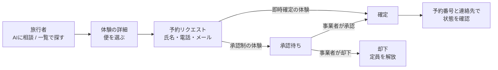
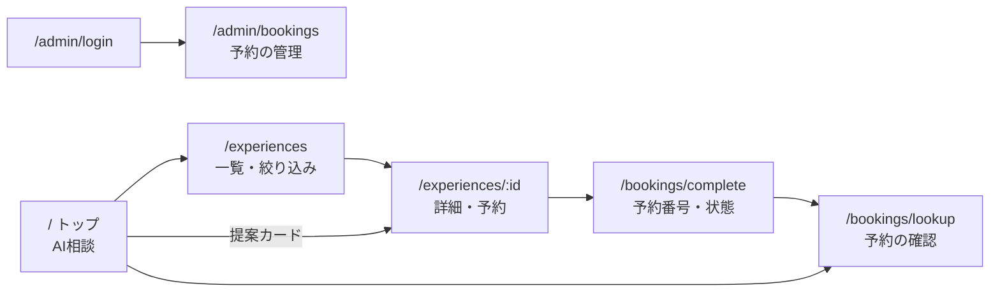
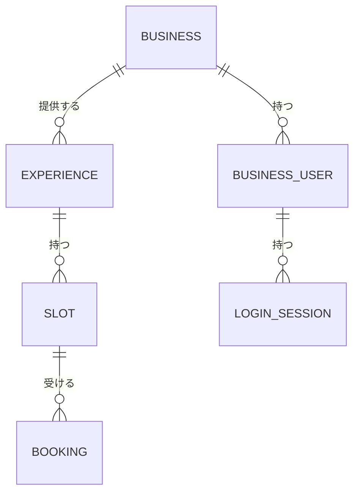
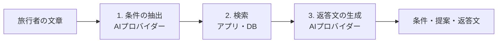

# シマタビ（仮）設計の要約

沖縄の小規模な体験事業者と旅行者をつなぐ、体験予約プラットフォームのMVPの設計と、作ったものの要約である。詳細は、`docs/product/`（方針・設計）と `docs/adr/`（設計判断）にあり、各章から参照する。動かし方は [README](../README.md)、デモの結果は [デモのチェックリスト](demo-checklist.md) にある。

## 1. MVPスコープ

**最優先にしたこと**: 中核の流れ（探す → 予約リクエスト → 事業者が承認 → 確定）を、最後まで通すこと。次に、事業者が最も恐れる**ダブルブッキングを起こさない**こと。そして、予約者の個人情報を守ること（暗号化・既定で伏せ字・事業者ごとの認可）。この3つは、時間が足りなくても縮小しないと決めた。理由は、事業者の信頼の根幹で、あとから直すと影響が大きいからである。AI機能は、必須要件で、創業者の構想の中心なので、「探す入口」として1つに絞って入れた。

| 区分 | 内容 | 判断の理由 |
|---|---|---|
| 作った（P0） | 体験の一覧・詳細・絞り込み／便と定員管理／予約と予約番号での確認／事業者の予約管理（承認・却下）／即時確定と承認制の切替／AIコンシェルジュ（モック）／個人情報の保護／事業者のログインと認可／デモ用のシード | 中核の流れと、信頼の根幹。対立する要望（すぐ確定したい／承認してから確定したい）は、体験ごとの切替1項目で両方満たす |
| 作っていない（P1） | 便の中止と参加者への連絡文、地図のリンク、LLM APIへの接続 | 中核が動いたあとの余力で扱う順番にした。AIは、差し替え口を先に作ってあるので、後から足せる |
| 見送り | 事業者による体験・便の登録UI（シードで代替）、運営の管理画面、多言語、追加のセキュリティ対策、LINE・メールの実送信、オンライン決済、レビュー | 開発が重い、または、効果が出るのが先になる。理由は [MVPスコープ](product/mvp-scope.md)の7章 |

## 2. 画面構成とデータモデル

旅行者の画面はスマホ幅、事業者の画面はPC幅を基本にした。事業者の画面は、承認待ちの件数を上に出し、承認・却下を一覧から直接行う（却下は、元に戻せないので確認を挟む）。氏名・電話・メールは伏せ字で、「連絡先を表示」を押した1件だけ、平文にする。

**定員を守る仕組み**（[設計の概要](product/design-overview.md)の3.4節、[ADR 0002](adr/0002-tech-stack-and-database.md)）: 便が予約済み人数（`booked_count`）を持ち、予約の作成を、条件付きUPDATE（「受付中・開始前・加算後が定員以下」のときだけ加算）で行う。更新が0行なら、予約を作らず409を返す。行ロックに頼らないので、DBがPostgreSQLに変わっても同じ考え方で使える。承認待ちの予約も定員に数え、却下で解放する。同時に予約を送るテストで、定員を超えないことを確かめている。

**個人情報と認可**（[ADR 0003](adr/0003-authentication-session.md)、[ADR 0004](adr/0004-pii-encryption-and-masking.md)）:

- 氏名・電話・メールは、暗号化して保存する。緊急連絡に使うので、元に戻せない変換（ハッシュ）は使えない。
- マスクはサーバー側で行い、平文は、「連絡先を表示」のAPIだけが返す。
- ログインは、サーバー側のセッション（HttpOnlyのCookie、DBにはハッシュを保存）。事業者向けのAPIは、ログイン中の事業者のデータだけを対象にし、他社のデータは404にする。

## 3. AI機能の設計

**役割**: 旅行者の「探す入口」。文章から検索条件を取り出し、体験を理由つきで提案する。**予約はしない。** 提案から、詳細の画面へ進んで、人が予約する。

| 判断 | 理由 |
|---|---|
| 検索は、AIではなく、アプリがDBで行う。提案の理由も、DBの事実から、アプリが作る | 存在しない体験を提案しない（幻覚の防止）。空き状況は、常に、DBの値になる |
| 実装レベルは、ルールベースの**モック**（LLMを使わない） | 入出力の約束と、画面・検索の流れを、短い時間で固めて、デモできる。キー・費用・応答の揺れに左右されない |
| AIプロバイダーの約束事（`extract_conditions`、`compose_reply`）を定義し、環境変数 `AI_PROVIDER` で切り替える | LLMへの差し替え口を、2つの操作に限定した。LLM接続（P1）を、短時間で足せる |
| 0件のときは、条件を1つずつ外してDBで再検索し、件数のある緩め方だけを返す | 「雨の条件を外すと1件あります」のように、行き止まりにしない |

**安全策**: AIへの入力は、旅行者の文章と現在時刻だけで、予約者の連絡先は渡さない。画面に「個人情報は入力しないでください」と出し、文章はログに残さず、応答にも含めない。AIが出した条件は、型（`Conditions`）で検証してから使い、AIの出力で予約や更新を行わない。詳細は、[設計の概要](product/design-overview.md)の6章。

## 4. 開発でのAI活用

AI（Claude Code）に、設計の下書きから、実装、テスト、PR本文までを任せ、人が、判断と承認とレビューを行った。

| 場面 | 指示の出し方 | AIの担当 | 人の担当 |
|---|---|---|---|
| 設計 | 課題文書を読ませ、論点（目的・優先度・MVP・非機能）ごとに、選択肢とメリット・デメリットを出させた | 論点の整理、選択肢の比較、文書の下書き | 設計判断（決める項目の確定）、文書のレビュー |
| 実装（Issue A〜G） | 受け入れ条件つきのIssueを渡し、**コードを書く前に、変更するファイル・方針・テスト方法・選択理由を、計画として出させた** | 計画、実装、テスト、確認、PR本文の下書き | 計画の承認、PRのレビューとマージ、設計に関わる質問への回答 |
| 検証 | 完了の前に、テスト・lint・型チェック・ビルドを実行させ、失敗も、そのまま報告させた | 実行と報告、画面の手動確認（ブラウザの操作） | 結果の確認、提出前の再確認 |
| 振り返り | AIの出力に手直しが必要だったとき、原因と対策を `docs/ai-dev-log.md` に記録させた | 記録の下書き | ルールにするかの判断 |

- 実装は、Issue 1つにつきPR 1つ（PR #11〜#17）。PRの本文に、変更内容、実行したテストとその結果、AIの担当範囲を書いた。
- 品質の確認: バックエンドは、325件のテスト（同時に予約を送って定員を守ることの確認を含む）、`ruff`、`mypy`（strict）。フロントエンドは、`eslint`、`tsc`、ビルド。フロントエンドの自動テストは、時間の配分のため、作らず、手動のデモのチェックリストで確かめた。
- 手直しが必要だった点は、`docs/ai-dev-log.md` に記録している（実名を含む作成者情報の混入、確認していないコマンドの記載、依存の版に合わない型の注釈、削除の対象を広げすぎた事故、画面の見落としなど）。共通の傾向は、**確認する前に、思い込みで書いた**ことだった。対策として、「書く前に実際に実行して確認する」「削除は、対象を絞り、先に一覧を見る」などを、ルール化の候補にしている。
- 指標（PRごとの所要時間、手直しの割合）は、`docs/ai-dev-log.md` の表に、人が記入する。

## 5. 見送りと次の一手

本格開発に進む場合に、次にやること。優先度は、案である。

| 順 | やること | 内容・理由 |
|---|---|---|
| 1 | **便の中止と、参加者への連絡文（P1）** | 事業者の共通の困りごと（天候中止の連絡）。便の中止APIと、連絡文の下書き、通知の記録（実際の送信は、モックから始める） |
| 2 | **事業者による、体験・便の登録UI** | シードの代わりに、事業者が自分で登録できるようにする。これがないと、運用が始まらない |
| 3 | **LLMへの接続（P1）** | `AI_PROVIDER=llm` の実装。構造化出力で条件を受け取って検証し、失敗したらモックに戻す。時間制限・リトライ・利用量の上限を設ける |
| 4 | **セキュリティの追加** | CSRFトークン、ログインの試行回数の制限（ADR 0003）、暗号化の鍵の管理（鍵の入れ替え、KMSなど）、監査ログ、データの保持期間 |
| 5 | **クラウドへの配置** | フロントは静的ホスティング、APIはコンテナ、DBはマネージドのPostgreSQL（SQLite → PostgreSQL）、写真はオブジェクトストレージ。設計は [非機能・インフラ](product/non-functional-and-infra.md)の4.2節。マイグレーションの仕組みも入れる |
| 6 | **通知の実送信** | メールやLINEの連携。事業者の、今のLINEでのやり取りの置き換えに直結する |
| 7 | **CIと、フロントエンドの自動テスト** | GitHub Actionsで、テスト・lint・型チェック・ビルドを自動化する。画面の主要な流れの自動テストを足す |
| 8 | **運営の管理画面、多言語（英語）** | 権限の分け方と、体験の説明を言語別に持つ構造を、設計から始める |
| 9 | **小さな改善** | 電話番号を、ハイフンなしで保存するため、事業者の画面の伏せ字が `090****5678` になる（設計の例は `090-****-5678`）。入力どおりに保存するか、表示のときに整形する。シードの今日の便を、実行時刻に依存しないようにする |

**見送りのまま**にしておく機能（オンライン決済、レビュー、リピーター向けのコース、事業者向けのAI自動応答）は、利用者と事業者の反応を見てから、必要性を判断する。
